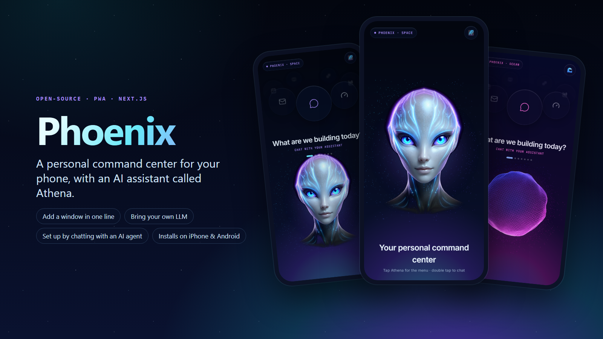
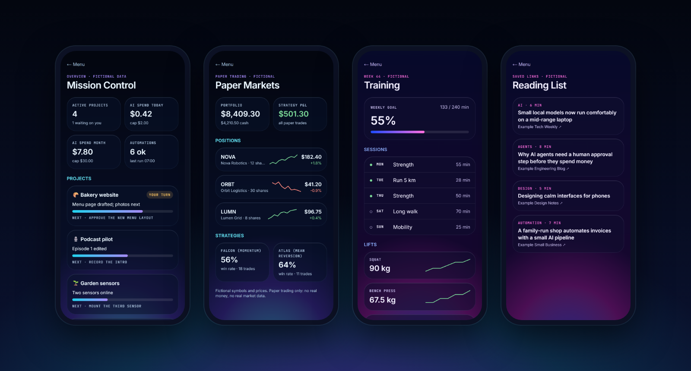
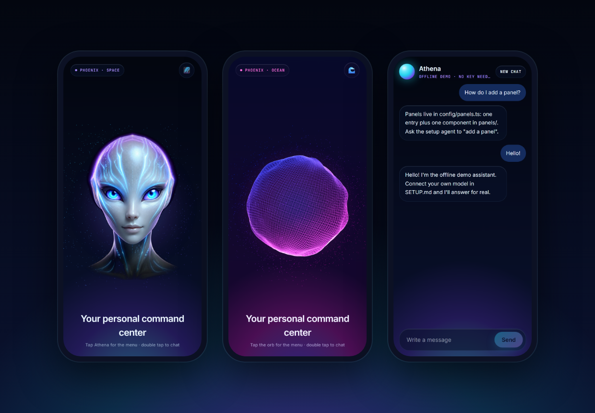

# Phoenix

**A personal command center for your phone, with an AI assistant called Athena.**

[](https://github.com/Phoenix84-Gr/phoenix-app/actions/workflows/ci.yml)
 
 [](LICENSE)



One app on your home screen for everything you check every day: your projects, your training, your reading list,
a practice portfolio, and an assistant you can talk to. Tap Athena and the menu glides out on an arc; every window
is one line in a config file, so you can make it *yours* in minutes. Or don't touch the code at all: open the folder
in Claude Code or Codex, say **"set it up"**, and a setup agent reshapes it with you.

## Try it in one minute

Needs [Node.js](https://nodejs.org) 22.18 or newer.

```bash
git clone https://github.com/Phoenix84-Gr/phoenix-app.git
cd phoenix-app
npm ci
npm run dev        # open http://localhost:3000 — tap Athena for the menu, double-tap to chat
```

No key, no account, nothing sent anywhere: the data is fictional and the assistant runs offline until you connect
your own model. Want it on your phone? [docs/INSTALL-ON-PHONE.md](docs/INSTALL-ON-PHONE.md) (iPhone and Android).

## Every window is a panel



```ts
// config/panels.ts — add a window: one entry here + one component in panels/<id>.tsx
{ id: "training", title: "Training", subtitle: "This week's sessions and lifts", icon: "dumbbell", status: "ready" },
```

The home menu, the URL (`/training`) and the tests all read the same list. Panels are built from shared glass
blocks (tiles, progress bars, sparklines) and get their data through a small adapter layer: fictional JSON by
default, and every value passes a strict parser before it reaches the page.

## Athena, two themes, your model



- **Space** shows Athena: one portrait brought to life by a WebGL shader. She blinks, her circuits glow, and her
  face tilts toward your finger or your phone's tilt. **Ocean** shows a wireframe orb displaced by 3D noise.
- **Chat** works offline out of the box. Connect OpenAI, OpenRouter, Ollama, LM Studio or any OpenAI-compatible
  server in `.env.local`: the model is called by the server, so the browser never sees your key.
- **Careful by default:** a real model needs an access code (the demo has no login), requests from other sites are
  refused, messages are rate-limited and size-capped, and the page runs only its own scripts (CSP with a nonce).

## Make it yours by talking to it

```
You:    set it up
Agent:  What windows do you want? How should it look? Real model or offline? On your phone?
        Plan: 1) panel-builder adds "Habits", removes "Paper Markets"  2) visual-adapter: green, name "Nova"
              3) connection-adapter: Ollama on this computer, no key.  OK?
```

The setup agent (`AGENTS.md`, `.claude/agents/`, `.claude/skills/`) hands each part to a specialist that edits only
its own files: **panel-builder** (windows), **visual-adapter** (look, words, icons) and **connection-adapter** (the
model). It runs the checks after every step, waits for your OK, and never reads your keys. Codex gets the same skills
through a generated mirror in `.agents/skills/`.

## What I built

Phoenix is the phone app I use every day as the front door to my own AI and automation projects. This repository is
a clean, public rebuild of it on the same structure: the same look, the panel registry, the assistant and the
security patterns, with fictional data and without the private parts (sign-in, my data, the laptop relay, the voice
link). I wrote the requirements and the security rules, designed the interface and the setup-agent structure,
reviewed every change and directed the fixes, including adversarial review rounds with a second AI model.

*Designed, specified, reviewed and directed by Babis Pimenidis; implemented with AI coding assistants (Claude Code,
Codex).*

## How it is built

| Part | Where | Notes |
|---|---|---|
| Panel registry | `config/panels.ts`, `panels/`, `app/[panel]/` | one list drives the menu, the routes and the tests; unknown ids are real 404s |
| Data layer | `lib/data.ts`, `lib/schema.ts`, `data/` | `DataSource` interface, `mock` by default; strict parsers, https-only links |
| Assistant | `app/api/assistant/route.ts`, `lib/assistant/` | server-side provider, access code, origin check, rate limits, streamed body cap, no redirects |
| Page security | `proxy.ts`, `next.config.ts` | CSP with a per-request nonce, no framing, nosniff, no-referrer, HSTS |
| Look | `app/globals.css`, `components/` | theme tokens, glass UI, Three.js orb and Athena shader, arc menu with momentum |
| Setup agent | `AGENTS.md`, `.claude/`, `.agents/skills/` | roles, rules, tailored skills, permission rules |

Tests: 44 unit tests on Node's built-in runner (registry, parsers, assistant handler with a fake provider, origin,
code, limits, page policy, setup kit) plus an end-to-end smoke script that CI runs against the built app, including
a check that a secret placed in the server environment shows up in no browser file, page or API answer.
More: [docs/architecture.md](docs/architecture.md) · [SECURITY.md](SECURITY.md) · [SETUP.md](SETUP.md).

## Limitations

- **No login.** It is built for fictional data. Real data needs the design in [docs/adapters.md](docs/adapters.md)
  first: sign-in, a server-side check on every page and route, least-privilege access, no caching of private pages.
- Rate limits live in memory on one server instance. The access code is a shared secret, not an account system.
- Message limits are not a money limit: set a spending cap with your model provider.
- No voice and no offline mode in this demo; the orb and Athena are ready for a voice signal but nothing drives it.
- The setup agent's rules are partly enforced (permissions, tool lists) and partly instructions; they reduce risk
  but are not a sandbox.

## Credits

Next.js, React, Tailwind CSS, Three.js and Lucide icons (see `package.json`; all MIT or ISC). Simplex noise GLSL by
Ashima Arts and Stefan Gustavson (MIT). Inter and JetBrains Mono fonts (SIL Open Font License), self-hosted at build
time. Athena's portrait was generated with an image model (GPT Image) for this project. App icon made for this
project. Claude Code and Codex are products of Anthropic and OpenAI.

## License

MIT, see [LICENSE](LICENSE).
